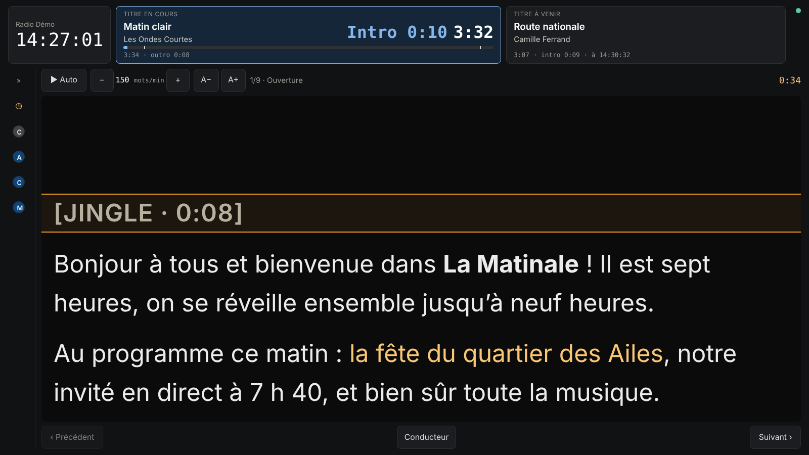
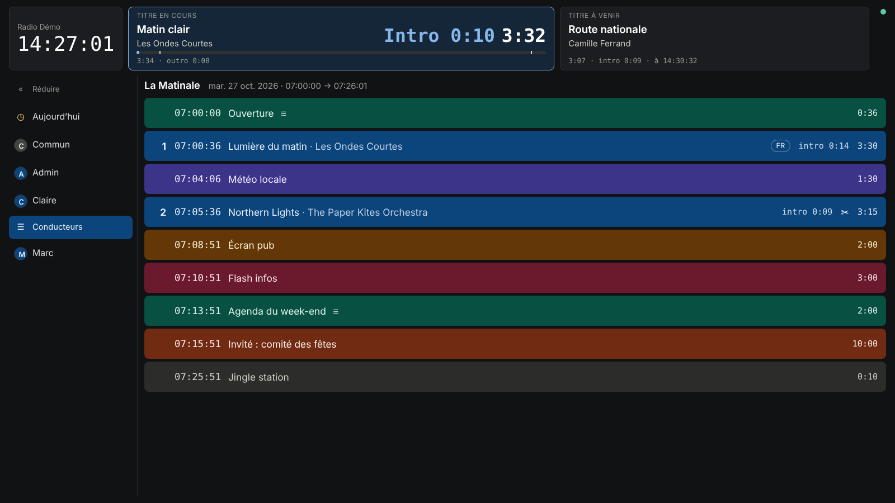
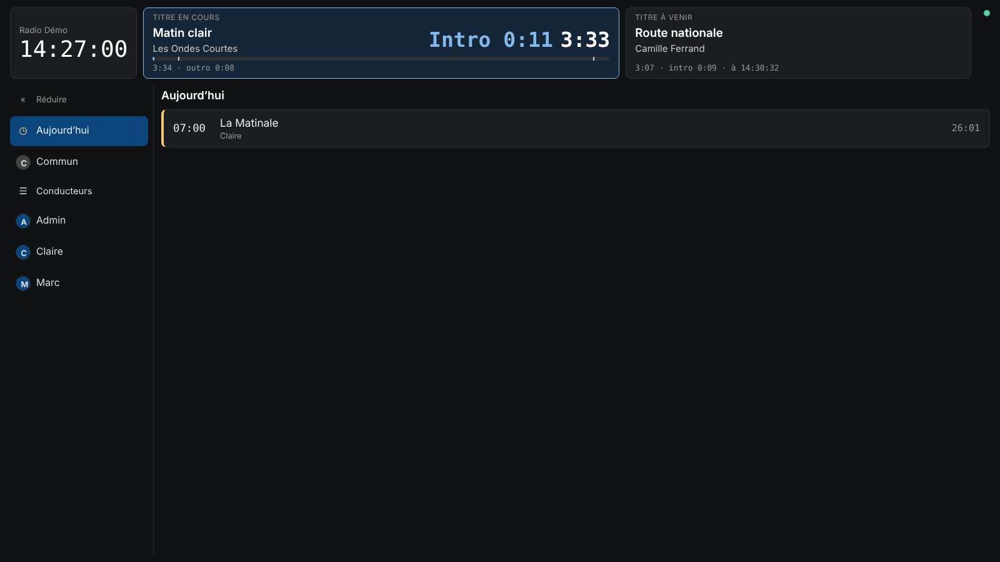
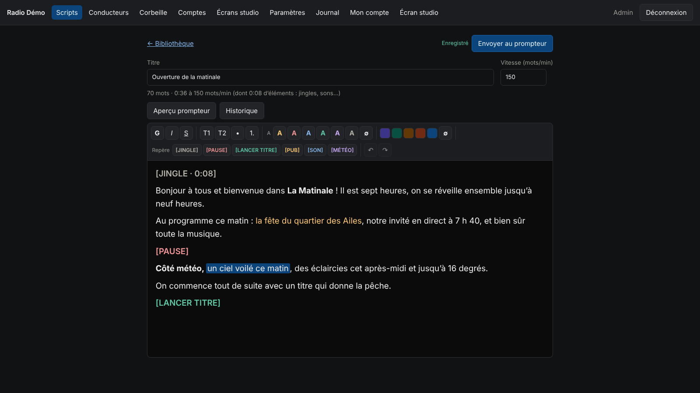
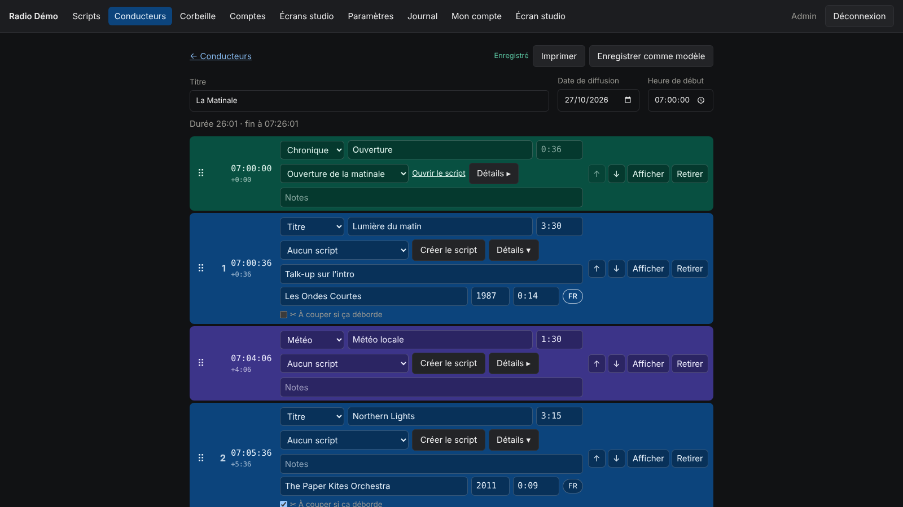
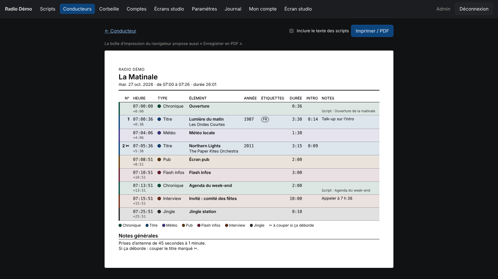

# OnAir-Desk

Écran studio pour radios, affiché dans un navigateur en mode kiosk, sur l'afficheur de votre choix : prompteur, conducteurs d'émission colorés, horloge à la seconde, titre en cours et à venir (depuis l'automation, RadioDJ en premier), météo et voyant On Air.



**Statut : étapes 1 (socle), 2 (scripts), 3 (écran studio), 4 (conducteurs), 5 (compléments conducteurs), 6 (socle antenne) et 7 (RadioDJ) réalisées.**

- Comptes, écrans kiosk, paramètres de la station, HTTPS, horloge synchronisée sur le serveur.
- Scripts : éditeur de texte enrichi avec repères, bibliothèque et dossiers, recherche, corbeille, historique, envoi au prompteur.
- Écran studio : navigation dans les dossiers à la souris, mode lecture avec bande de lecture, défilement molette ou automatique, Précédent / Suivant.
- Conducteurs : éléments colorés, heures de passage et position depuis le début, glisser-déposer, lien prompteur, duplication, modèles d'émission récurrente, impression / PDF en tableau coloré.
- Conducteur enrichi : titres musicaux numérotés avec artiste, année et intro (talk-up), repris de RadioDJ au choix d'un titre, étiquettes paramétrables (ex. FR), élément « à couper si ça déborde », notes générales du conducteur.
- Logo de la station (interface, connexion, écran studio, impressions).
- Socle antenne : titre en cours / à venir sur l'écran studio (simulateur d'automation en attendant RadioDJ et AzuraCast), journal d'audit consultable, tests de bout en bout (`npm run test:e2e`).

- RadioDJ : titre en cours et à venir, heure de démarrage, alerte de fin de titre, repères intro / outro, talk-over, titres musicaux dans les conducteurs.

Les autres intégrations (AzuraCast, On Air, météo) arrivent aux étapes suivantes (voir [`CLAUDE.md`](CLAUDE.md) §8).

### Aperçu

| Écran studio : conducteur du jour                                                                                                                                                              | Écran studio : navigation                                                                                                                                                                 |
| ---------------------------------------------------------------------------------------------------------------------------------------------------------------------------------------------- | ----------------------------------------------------------------------------------------------------------------------------------------------------------------------------------------- |
|                |                                                       |
| **Éditeur de script**                                                                                                                                                                          | **Montage d'un conducteur**                                                                                                                                                               |
|                                      |  |
| **Impression / PDF du conducteur**                                                                                                                                                             |                                                                                                                                                                                           |
|  |                                                                                                                                                                                           |

Captures faites sur une base de démonstration (simulateur d'automation) ; pour les régénérer après une évolution de l'interface : `npm run build` puis `npm run captures`.

- [`CLAUDE.md`](CLAUDE.md) : cahier des charges et décisions (fait foi).
- [`docs/plan-etape-1.md`](docs/plan-etape-1.md), [`docs/plan-etape-2.md`](docs/plan-etape-2.md), [`docs/plan-etape-3.md`](docs/plan-etape-3.md), [`docs/plan-etape-4.md`](docs/plan-etape-4.md), [`docs/plan-etape-5.md`](docs/plan-etape-5.md), [`docs/plan-etape-6.md`](docs/plan-etape-6.md), [`docs/plan-etape-7.md`](docs/plan-etape-7.md) : plans et bilans des étapes.
- [`docs/maquette-ecran-studio-v3.html`](docs/maquette-ecran-studio-v3.html) : maquette de l'écran studio (à ouvrir dans un navigateur).

---

## Installation (Debian + Docker + Portainer)

L'image est construite par Portainer directement depuis ce dépôt : aucun registre n'est nécessaire.

### 1. Jeton GitHub en lecture seule

Le dépôt étant privé, Portainer a besoin d'un accès en lecture :

1. GitHub → _Settings_ → _Developer settings_ → _Personal access tokens_ → **Fine-grained tokens** → _Generate new token_.
2. _Repository access_ : **Only select repositories** → `OnAir-Desk`.
3. _Permissions_ : **Contents : Read-only** (rien d'autre).
4. Choisir une **date d'expiration**, générer, copier le jeton.

Ce jeton n'est saisi que dans Portainer. Il ne doit jamais être écrit dans le dépôt.

### 2. Stack Portainer

_Stacks_ → _Add stack_ → **Repository** :

| Champ                | Valeur                                              |
| -------------------- | --------------------------------------------------- |
| Name                 | `onair-desk`                                        |
| Repository URL       | `https://github.com/dockev03/OnAir-Desk`            |
| Repository reference | `refs/heads/main` (ou la branche à déployer)        |
| Compose path         | `docker-compose.yml`                                |
| Authentication       | activée : votre nom d'utilisateur GitHub + le jeton |

Puis, dans _Environment variables_, renseigner au minimum `PUBLIC_ORIGIN` (voir [`.env.example`](.env.example)) :

| Variable        | Exemple                                       | Rôle                                                                          |
| --------------- | --------------------------------------------- | ----------------------------------------------------------------------------- |
| `PUBLIC_ORIGIN` | `https://onair-desk.lan,https://192.168.1.20` | **Obligatoire.** Toutes les adresses utilisées par l'afficheur et les postes. |
| `TLS_HOSTNAMES` | _(vide)_                                      | Noms et IP du certificat ; par défaut ceux de `PUBLIC_ORIGIN`.                |
| `HOST_PORT`     | `443`                                         | Port publié sur la Debian.                                                    |
| `TZ`            | `Europe/Paris`                                | Fuseau du conteneur.                                                          |

Pour RadioDJ (facultatif), trois variables de plus : voir la section [RadioDJ](#6-radiodj-facultatif).

_Deploy the stack_. La première construction prend quelques minutes.

### 3. Premier lancement

1. Portainer → _Containers_ → `onair-desk` → **Logs** : repérer le bloc « premier lancement » et son **code d'installation**.
2. Ouvrir `https://<adresse>/setup` (le navigateur signale un certificat inconnu : c'est normal tant que le certificat racine n'est pas installé, voir ci-dessous).
3. Saisir le code, le nom de la station, puis créer le compte administrateur.

Tant que l'installation n'est pas faite, un nouveau code est généré à chaque redémarrage. Une fois l'admin créé, la page d'installation est fermée définitivement.

### 4. Certificat racine (HTTPS)

OnAir-Desk crée sa propre autorité de certification au premier démarrage. Pour que les navigateurs lui fassent confiance, installez **une fois** son certificat racine sur chaque appareil. Il est téléchargeable à la fin de l'installation, ou dans _Paramètres_ (`https://<adresse>/api/tls/root-ca.crt`).

- **Windows** : double-clic sur `onair-desk-root-ca.crt` → _Installer le certificat_ → _Ordinateur local_ → _Placer tous les certificats dans le magasin suivant_ → **Autorités de certification racines de confiance**. Chrome et Edge l'utilisent aussitôt.
- **Linux (Debian, Ubuntu…)** (système) :
  ```bash
  sudo cp onair-desk-root-ca.crt /usr/local/share/ca-certificates/onair-desk.crt
  sudo update-ca-certificates
  ```
  Chromium sous Linux utilise en plus sa propre base (paquet `libnss3-tools`) :
  ```bash
  certutil -d sql:$HOME/.pki/nssdb -A -t "C,," -n "OnAir-Desk" -i onair-desk-root-ca.crt
  ```
- **Firefox** : _Paramètres_ → _Vie privée et sécurité_ → _Certificats_ → _Afficher les certificats_ → _Autorités_ → _Importer_.

Le certificat serveur est renouvelé automatiquement ; la racine, valable 10 ans, ne change pas. Si vous ajoutez une adresse dans `PUBLIC_ORIGIN`, un nouveau certificat serveur est émis au redémarrage, sans rien réinstaller sur les postes.

Pour utiliser un certificat existant de la station, voir les lignes `TLS_CERT_FILE` / `TLS_KEY_FILE` commentées dans [`docker-compose.yml`](docker-compose.yml).

### 5. Écran studio (kiosk)

1. _Administration_ → **Écrans studio** → _Ajouter un écran_.
2. Copier l'adresse affichée (`https://<adresse>/studio#token=…`). **Elle n'est montrée qu'une fois.**
3. Sur l'afficheur, ouvrir cette adresse dans un navigateur en mode kiosk (par exemple Chromium avec `--kiosk`). Le matériel est au choix de la station. Le jeton, placé après le `#`, n'est jamais envoyé au serveur dans l'URL : la page l'échange contre un cookie sécurisé, puis le retire de la barre d'adresse.

Sur l'écran, tout se fait à la souris : choisir un dossier puis un script ouvre le **mode lecture** (molette, bouton **Auto**, vitesse −/+, taille A−/A+, Précédent / Suivant). Pour sortir, **maintenir** le bouton « Sortir » une seconde.

L'écran est en **lecture seule**, à une exception près : il peut choisir le script affiché. Il peut être **révoqué** (déconnexion immédiate) ou recevoir un **nouveau jeton** depuis la même page.

### 6. RadioDJ (facultatif)

OnAir-Desk lit le titre en cours, le titre à venir et les repères (intro, point de mix) **dans la base de RadioDJ, en lecture seule**. Le plugin « Metadata Export » de RadioDJ le prévient à chaque nouveau titre ; sans lui, la base est relue toutes les 5 secondes. Constats techniques : [`docs/cadrage-radiodj.md`](docs/cadrage-radiodj.md).

**Sur le PC RadioDJ (MariaDB)** :

1. Créer un compte avec le **seul droit de lecture**, limité à l'adresse de la Debian :
   ```sql
   CREATE USER 'onairdesk'@'<ip-de-la-debian>' IDENTIFIED BY '<mot-de-passe-fort>';
   GRANT SELECT ON radiodj.* TO 'onairdesk'@'<ip-de-la-debian>';
   ```
2. ⚠️ **Exposition réseau** : MariaDB doit accepter les connexions réseau (`bind-address`) et le pare-feu Windows doit ouvrir le port 3306 **à la seule adresse de la Debian**.
3. Régler l'horloge du PC par **NTP** : l'heure de passage des titres vient de ce PC quand le signal du plugin manque.

**Dans la stack Portainer** :

| Variable              | Exemple        | Rôle                                                                                                                                                               |
| --------------------- | -------------- | ------------------------------------------------------------------------------------------------------------------------------------------------------------------ |
| `RADIODJ_DB_PASSWORD` | _(secret)_     | Mot de passe du compte ci-dessus. Jamais stocké dans OnAir-Desk ni renvoyé par l'interface.                                                                        |
| `CONNECTOR_HTTP_PORT` | `8780`         | ⚠️ Ouvre le **port HTTP dédié aux connecteurs** (RadioDJ refuse le certificat HTTPS interne). Vide : fermé. Seule la route du signal y répond, protégée par jeton. |
| `CONNECTOR_BIND`      | `192.168.1.20` | Adresse de la Debian sur laquelle publier ce port. Par défaut `127.0.0.1` : injoignable depuis le réseau.                                                          |

**Dans OnAir-Desk** : _Administration_ → **Paramètres** → Source d'automation **RadioDJ** : renseigner le poste, la base et l'utilisateur, **Tester la connexion**, enregistrer, puis **Générer le jeton** du plugin (montré une seule fois).

**Dans RadioDJ** : plugin **Metadata Export**, onglet **Web** :

- URL : `http://<adresse-de-la-debian>:8780/api/connectors/radiodj` (rappelée dans les Paramètres) ;
- Password : le jeton ; **Custom Data : vide** ; méthode **POST** ;
- cocher la case _Enable_ de la ligne, l'ajouter (➕), cocher le _Enable_ du bas, puis **Save** ;
- onglet **Filters** : laisser décochés _Sweeper_, _Voiceover_ et _Playlist Event_ (habillages joués par-dessus un titre, ou pas de son).

Les intros non marquées dans RadioDJ n'ont pas de compte à rebours de talk-over : marquer les repères dans RadioDJ pour en profiter.

### 7. AzuraCast et bascule direct / hors direct (facultatif)

OnAir-Desk lit le titre en cours et le titre à venir dans l'**API « Now Playing » d'AzuraCast**, en HTTPS : un flux temps réel (SSE) prévient à chaque changement, et l'état est relu toutes les 30 secondes. Toutes les connexions partent d'OnAir-Desk vers AzuraCast : **aucun port à ouvrir** côté OnAir-Desk. Si la Debian est filtrée en sortie, autoriser le HTTPS vers l'adresse d'AzuraCast.

**Certificat d'AzuraCast** : la vérification HTTPS n'est jamais désactivée.

- **Recommandé** : un certificat **Let's Encrypt** sur AzuraCast (_Administration_ → _Paramètres système_ → _Services_ ; il faut un nom de domaine). Rien à faire côté OnAir-Desk.
- Certificat **auto-signé** : copier son certificat (format PEM) sur la Debian, par exemple dans `/etc/onair-desk/certs/azuracast.crt`, décommenter le volume `/etc/onair-desk/certs:/certs:ro` dans [`docker-compose.yml`](docker-compose.yml) et renseigner `AZURACAST_CA_FILE=/certs/azuracast.crt`. Ce certificat n'est accepté que pour AzuraCast.

**Clé API** (si la page publique de la station est désactivée) :

1. Dans AzuraCast, créer un **compte dédié** à OnAir-Desk, **sans aucun rôle d'administration** ni droit de gestion de station. ⚠️ Une clé AzuraCast a **tous les droits du compte** qui l'a créée : ne jamais utiliser la clé d'un administrateur.
2. Avec ce compte : _Mon compte_ → _Clés API_ → créer une clé.
3. La renseigner dans la variable `AZURACAST_API_KEY` de la stack (secret : jamais stocké dans OnAir-Desk, jamais renvoyé par l'interface ni journalisé). Elle est envoyée dans un en-tête, seulement après vérification du certificat. Changer de clé : modifier la variable et redéployer.

| Variable            | Exemple                | Rôle                                                                      |
| ------------------- | ---------------------- | ------------------------------------------------------------------------- |
| `AZURACAST_API_KEY` | _(secret)_             | Clé API du compte dédié. Vide : aucune clé (station publique).            |
| `AZURACAST_CA_FILE` | `/certs/azuracast.crt` | Certificat auto-signé d'AzuraCast à accepter. Vide : autorités publiques. |

**Dans OnAir-Desk** : _Administration_ → **Paramètres** :

- **Source unique** AzuraCast, ou mode **Direct / hors direct** : source du direct (ex. RadioDJ) et source hors direct (AzuraCast). Les deux tournent en même temps : le passage de l'une à l'autre est immédiat.
- **Bascule** : _Automatique_ (direct dès qu'AzuraCast signale un DJ connecté, ce qui suppose que le direct RadioDJ passe par AzuraCast en tant que DJ / streamer), ou forcée (_Forcer le direct_ / _Forcer hors direct_). Chaque bascule est notée au journal.
- **AzuraCast** : adresse (`https://…`), **nom court** de la station (visible dans l'adresse de sa page publique), **retard du flux** (secondes) pour que le temps restant colle à ce qu'on entend, puis **Tester la connexion** (indique aussi si la clé API est nécessaire, acceptée ou refusée).

Sans repère intro / outro dans l'API d'AzuraCast, il n'y a pas de compte à rebours de talk-over pour ses titres. En direct, le titre envoyé par l'encodeur s'affiche sans temps restant.

### 8. Écran de veille et dispositions

- **Écran de veille** : quand aucun conducteur du jour n'est en cours (avec 10 minutes de marge avant et après) et que l'antenne n'est pas en direct, l'écran studio affiche l'horloge, le voyant On Air, le titre en cours et la prochaine émission. Il disparaît seul quand une émission commence ; un clic le quitte pour 10 minutes.
- **Dispositions** : _Animateur seul_, _Émission avec régie_ (zone réservée aux messages régie), _Interview_ (bandeau réduit). Elles se choisissent sur le **modèle d'émission** et sur le **conducteur** ; la disposition par défaut se règle dans les Paramètres.
- **Usure de l'écran** : les éléments fixes se décalent de quelques pixels toutes les 2 minutes, et la veille dérive lentement (désactivable dans les Paramètres).

### Mise à jour

Portainer → _Stacks_ → `onair-desk` → **Pull and redeploy**. Les données restent dans le volume `onair-desk-data`. Avant d'appliquer une migration de base, le serveur en fait une copie dans `/data/backups/` (5 dernières conservées).

### Sauvegarde

Tout est dans le volume `onair-desk-data` : base SQLite, autorité de certification, sauvegardes automatiques. Arrêter la stack le temps de la copie, puis :

```bash
docker run --rm -v onair-desk_onair-desk-data:/data:ro -v "$PWD":/backup debian:trixie-slim \
  tar czf /backup/onair-desk-$(date +%F).tgz -C /data .
```

Le nom exact du volume est visible dans Portainer → _Volumes_. **La sauvegarde contient la clé privée de l'autorité de certification** : la conserver en lieu sûr.

---

## Sécurité

- **Réseau interne uniquement** : ne jamais publier le port d'OnAir-Desk sur Internet.
- **HTTPS obligatoire** en production (le serveur refuse de démarrer en HTTP).
- Mots de passe hachés en **Argon2id** ; sessions et jetons d'écran stockés **hachés** ; cookies `httpOnly`, `Secure`, `SameSite=Strict`.
- Protection **CSRF** (vérification de l'en-tête `Origin`), politique **CSP** stricte, limitation des tentatives de connexion.
- Conteneur durci : utilisateur non-root, système de fichiers en lecture seule (sauf `/data`), aucune capacité Linux, `no-new-privileges`.
- Journal des actions sensibles (connexions, comptes, écrans) dans la table `audit_log`.
- L'afficheur en kiosk ouvre une session sans intervention : il doit rester dans le studio, sur un réseau maîtrisé.
- AzuraCast (facultatif) : connexions **sortantes** seulement, en HTTPS avec certificat **toujours vérifié** ; clé API facultative en variable d'environnement, liée à un compte **sans droit d'administration**, jamais journalisée ni renvoyée.
- RadioDJ (facultatif) : base lue avec un compte **SELECT seul** ; port HTTP dédié aux connecteurs **fermé par défaut**, limité à la route du signal (jeton stocké haché, limitation de débit). Son jeton circule en clair sur le réseau local : la requête n'est qu'un signal, la base fait foi.

---

## Développement

Prérequis : Node.js 22 ou 24, et **npm 11.21.1** (utilisé pour le fichier de verrouillage et l'autorisation des scripts d'installation, champ `allowScripts`).

```bash
npx npm@11.21.1 install      # dépendances
npm run dev:server           # API sur http://localhost:8443 (HTTP en développement, données dans ./data)
npm run dev:web              # interface sur http://localhost:5173 (relaie /api vers le serveur)
```

Le code d'installation s'affiche dans le terminal du serveur.

| Commande            | Rôle                                            |
| ------------------- | ----------------------------------------------- |
| `npm run lint`      | ESLint + Prettier                               |
| `npm run typecheck` | TypeScript (serveur, interface, paquet partagé) |
| `npm test`          | Tests (Vitest)                                  |
| `npm run build`     | Construction de l'interface puis du serveur     |
| `npm run test:e2e`  | Tests de bout en bout (après le build)          |
| `npm run captures`  | Captures d'écran du README (après le build)     |

### Organisation

```
apps/server     API Fastify (REST + WebSocket), HTTPS, SQLite ; sert aussi l'interface compilée
apps/web        Interface SvelteKit compilée en fichiers statiques (FR / EN)
packages/shared Schémas de validation et types communs
```

La CI GitHub Actions lance lint, typecheck, tests, build et construction de l'image Docker sur chaque push.

## Licence

À définir (dépôt privé en attendant).
